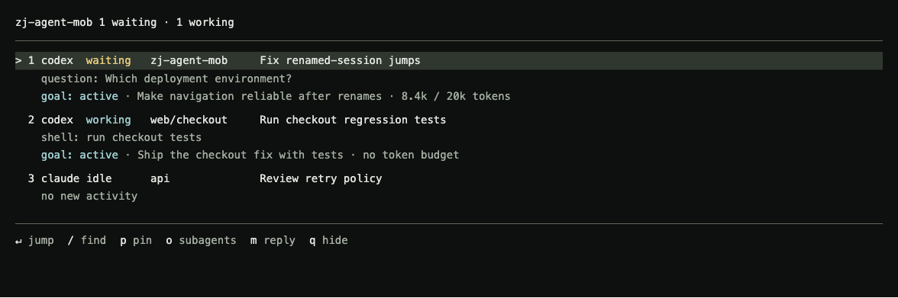
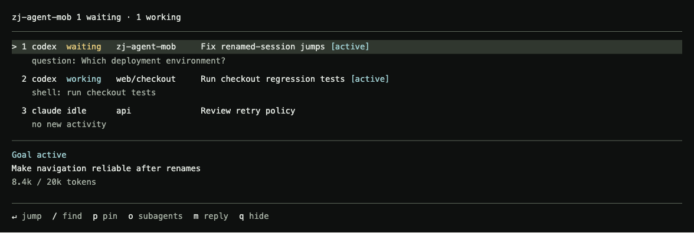
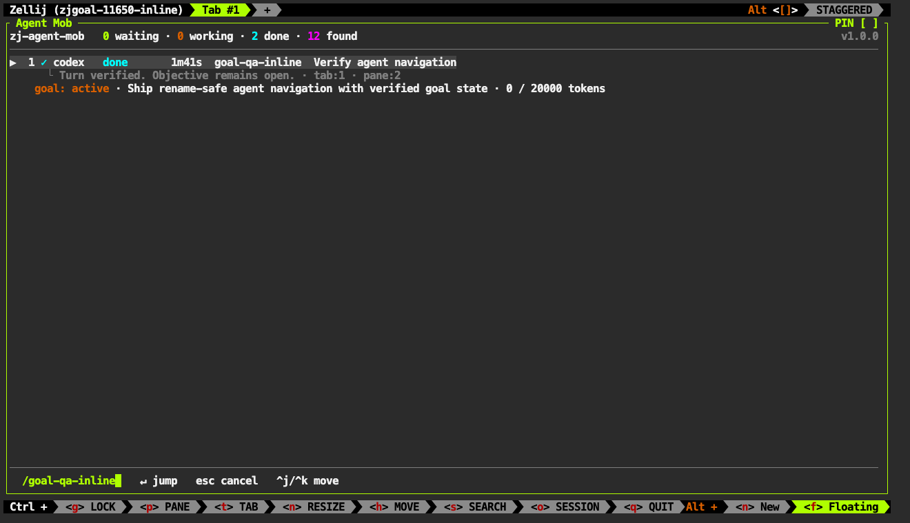
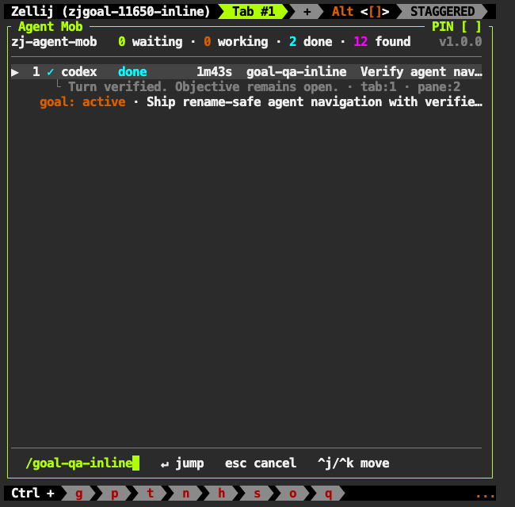
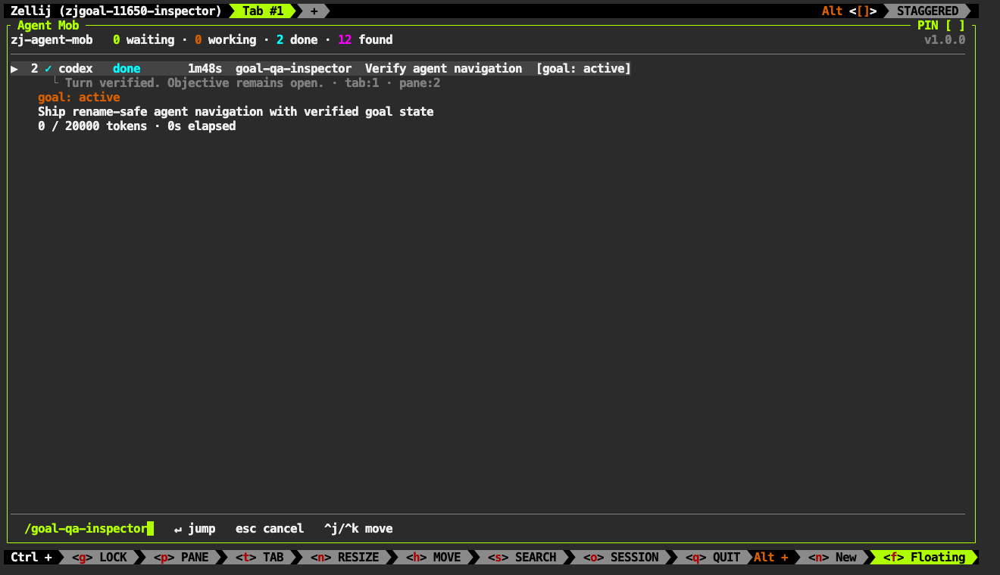
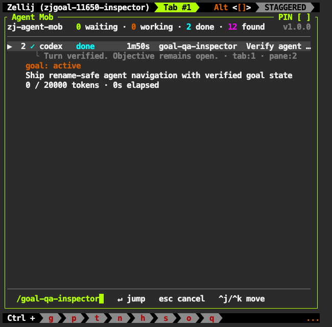

# Goal status and reliable agent navigation

Date: 2026-10-30
Status: Implemented and locally verified on 2026-10-30.

## Scope

This work has three deliverables:

1. Fix navigation after pane and Zellij session renames.
2. Fix Codex input requests that appear as `done`.
3. Propose goal status, with mockups for approval before implementation.

Goal display is disabled by default. The installed plugin and agent configuration remain unchanged.

## Approval

Open [the interactive mockups](mockups/goal-status.html).
The preview has two layouts and ten scenarios. Its example objectives and token counts are illustrative.

| Proposal | Behavior | Tradeoff |
| --- | --- | --- |
| Inline context, recommended | Add one goal line below each agent's existing detail line. | All objectives remain visible. Fewer agents fit vertically. |
| Selected inspector | Add a goal-state label to each row. Show the selected objective and budget below the list. | More agents fit. Other objectives require a selection change. |

Both proposals preserve the current terminal design, activity labels, urgency ordering, and existing shortcuts.
Agents with an explicit no-goal response keep their current rows.
Unknown goal support is different from an explicit no-goal response.

Approval covers the layout and state labels, not an unproven data source.
The first implementation gate establishes whether the runtime exposes authoritative goal data through hooks.

### Inline context

### Selected inspector

## Evidence and root causes

### Navigation

The existing row identity uses the sanitized Zellij session name and terminal pane ID.
The pane title is a label, not an address. Pane IDs remain the correct address after a title change.

The failure has several paths:

- `SessionUpdate` changed the panel's session name without migrating its rows or bound actions.
- An existing shell retained its original `ZELLIJ_SESSION_NAME` after a session rename.
- Process discovery read the original name from the server command line.
- A dead foreign row still called `switch_session_with_focus`, without a target pane.
- Row sorting kept a numeric cursor position, which could select a different agent.

A throwaway Zellij 0.45.1 session established the rename behavior directly.
The session changed from `zjrnqa` to `zjrnqa-renamed`.
Its server PID stayed constant, and its command line still contained the original socket name.
A new pane received the new session name. Existing processes retained their inherited identity.

The dependency remains `zellij-tile` 0.44.3. Its `PluginIds` contains the server PID.
No dependency upgrade is part of this fix.

### Codex input status

The hook previously mapped every `Stop` event to `done`.
It also treated every `PreToolUse` event as a working heartbeat.
Thus a `request_user_input` call did not enter the existing `waiting` state.

The [supplied hooks contract](https://learn.chatgpt.com/docs/hooks) defines turn and tool events.
It does not define a goal lifecycle event or a universal Codex needs-input notification.
Its `Stop` payload includes `last_assistant_message`. A stopped turn does not prove that an objective is complete.

The new regression tests reproduced these failures before the hook fix:

- Question tools with heartbeats disabled emitted no status.
- A closing message such as `Which environment can I deploy to?` emitted `done`.

## Bug fixes in this change

### Rename-safe navigation

The implementation keeps pane IDs and resolves the current session name through the server identity.

- Hooks report the ancestor Zellij server PID.
- Each panel publishes `server.<pid>` with the current session name and server start time.
- The hook and discovery scan reject routes with a different process start time.
- Discovery walks process ancestry instead of trusting inherited session names alone.
- Session renames migrate rows, pins, prompts, replies, searches, and expanded subagents.
- Existing verdict paths remain unchanged because the parked hook still reads those paths.
- An inherited old shell name resolves to the renamed session.
- The pipe uses the resolved address, not the shell's inherited address.
- The hook saves its timestamped status before delivery. Polling recovers lost local pipes without overwriting newer reports.
- Pipe delivery has a four-second deadline through `timeout`, `gtimeout`, or Perl. Without a deadline tool, polling supplies status.
- A reused old session name remains separate through its own server PID.
- Sorting preserves the selected agent's identity.
- Cross-session jumps check the live terminal pane before switching sessions.
- A missing target cancels the jump and keeps the panel visible.
- A jump never intentionally resurrects a dead session or falls back to a tab position.

The existing status spool remains readable. The additional fields and server routes are additive.
Names with spaces still use the existing sanitizer for keys and the real name for addressing.

Relevant files: [hook](../scripts/zj-agent-mob-hook.sh), [discovery](../src/discover.rs),
[state](../src/state.rs), [keyboard actions](../src/keys.rs), [host calls](../src/host.rs),
and [event handling](../src/plugin.rs).

### Codex input requests

Structured question tools now enter `waiting` with `block=question` before the tool runs.
Their result returns the row to `working`. These transitions remain active with ordinary heartbeats disabled.
Namespaced forms of `request_user_input` and `AskUserQuestion` are recognized.
Question tools do not create permission-verdict prompts.

Codex also has a closing-question fallback for plain-text requests.
It recognizes a direct question at the end of the final paragraph.
Completed answers, quoted questions, and fenced examples have regression coverage.
The fallback updates the pipe and cross-session spool together.

This fallback is a text heuristic, not a new runtime contract.
It does not cover every language or every request without a question mark.
Set `ZJ_AGENT_CODEX_QUESTIONS=0` to disable only this fallback.
Structured question-tool handling remains active.

## Proposed goal model

Activity answers: **What does the agent need or do now?**
Goal state answers: **What happened to the persistent objective?**

These signals must remain independent:

| Activity | Goal | Interpretation |
| --- | --- | --- |
| `working` | `active` | The current turn works toward an open objective. |
| `waiting` | `active` | The agent needs an answer. No explicit goal-state change occurred. |
| `done` | `active` | The turn ended. The objective remains open. |
| `idle` | `paused` | The source explicitly reports a paused goal. |
| `idle` | `blocked` | The source explicitly reports a blocked goal. |
| `idle` | Budget-limited | The source explicitly reports a budget stop, not completion. |
| `done` | `complete` | The source explicitly reports completion. |
| Any | Unknown | The source cannot establish goal state. |

Only a successful authoritative update or snapshot can report `complete`.
Neither `Stop`, an approval request, a tool failure, nor silence can complete a goal.
A failed turn does not automatically fail the goal.

Budget use is separate from both signals.
For example, `20k / 20k tokens` means that the reported token budget is consumed.
It does not mean that the work is complete or that the goal is paused.
An explicit budget-limited state uses a separate label.
Unknown runtime stop reasons remain unknown until their schemas are established.

## Data-source gate

The current hook does not consume goal data.
The supplied hooks page lists no `GoalUpdated` event.
The hooks contract covers local function tools, including nested calls from code mode.
Specialized tool paths can opt out. Actual goal-tool fixtures still need inspection.

The [App Server contract](https://learn.chatgpt.com/docs/app-server#manage-a-thread-goal) provides a supported goal source:

- `thread/goal/get` reads a thread's persisted goal.
- `thread/goal/updated` and `thread/goal/cleared` report goal changes.
- Goal results include the objective, state, token use, optional budget, and elapsed time.

Prefer a read-only bridge to this source where the installed runtime supports it.
Use successful goal-tool results as immediate observations, not as the only refresh path.
User actions such as pause, resume, replacement, and clear must also reach the panel.

Before goal implementation:

1. Capture scoped `PreToolUse` and `PostToolUse` fixtures from a disposable goal-enabled thread.
2. Capture successful goal creation, observation, pause, block, completion, and replacement.
3. Establish the exact tool names, result envelopes, owner IDs, and ordering fields.
4. Establish how the runtime represents no goal, unavailable access, and budget limits.
5. Establish whether goal updates arrive directly or inside a structured wrapper.
6. Establish the hook session ID to goal thread ID mapping.
7. Exercise read-only `thread/goal/get` without starting or resuming an agent thread.
8. Measure a batched refresh against representative fleet sizes.

`get_goal` in this thread exposes `goal.threadId`, `objective`, `status`, `createdAt`, and `updatedAt`.
It also exposes token use and elapsed time. Optional budget fields require explicit handling.
This observation is evidence for this runtime, not a promise about every Codex CLI release.

The adapter can observe successful goal-tool results if the fixtures establish that contract.
The adapter must read the result, not the requested status in a pre-tool input.
A failed `update_goal` call must not change the panel.

Poll the established read-only source through the existing five-second refresh cadence.
Keep the timer active for known goals, including quiet local agents.
Batch snapshot reads in one bounded host command, without adding a permanent daemon.
An existing supported event connection can replace polling, but display must not resume a thread to subscribe.

Do not assume that a second App Server process can inspect every live thread.
The source gate must establish access and refresh cost in the installed build.
If that path fails, retain explicitly labeled last-reported observations or report unavailable support.
Do not read private Codex databases, scrape the screen, or infer goals from prompts.
The unsupported state remains useful and honest.

## Proposed transport and ownership

Use a separate typed goal snapshot. Do not place full objectives in comma-separated status arguments.
The current hook truncates ordinary task text to 60 characters and replaces punctuation.

Suggested snapshot fields:

| Field | Purpose |
| --- | --- |
| `schema_version` | Reject unsupported payload formats. |
| `agent_session_id` | Bind the snapshot to the current agent, not a recycled pane. |
| Server instance and pane ID | Resolve the row without using its title. |
| `thread_id` and goal generation | Distinguish a new objective from a prior goal. |
| `objective`, `status` | Preserve the authoritative objective and state. |
| `tokens_used`, optional `token_budget` | Describe resource use without a completion estimate. |
| `elapsed_seconds`, optional time limit | Preserve reported elapsed time and limits. |
| Source revision and observation time | Reject old updates and label old observations. |
| Support state | Distinguish a goal, explicit no goal, and unavailable data. |

Use the source goal ID if one exists.
Otherwise, use the established thread ID and creation identity, after the source gate establishes their guarantees.
Do not use objective text, pane titles, or mutable Zellij names as goal identity.

Proposed flow:

1. Observe a supported successful goal result.
2. Normalize and size-limit its snapshot.
3. Publish an `agent-goal` pipe with a JSON payload.
4. Atomically publish the same snapshot in the private spool.
5. Read foreign snapshots through the existing discovery poll.
6. Merge only snapshots for a live matching agent instance.

Prefer the source revision for ordering.
If no ordering field exists, reread the authoritative snapshot before publication.
Arrival order alone cannot establish the order of parallel tool results.
Deduplicate events by their established source identity.

Keep goal storage separate from ordinary heartbeat records.
An empty goal field in a heartbeat must not erase a known goal.
An explicit no-goal snapshot can clear it.
A new agent or goal generation must not inherit the previous objective.

Limit payload size and objective length at ingestion.
Remove terminal control sequences from display text.
Use private directories and atomic writes, as the current spool does.
Do not execute source text or accept arbitrary spool paths.

## UI behavior

- Preserve the current activity count and urgency ordering.
- Show goal state in text, not color alone.
- Keep a renamed pane as the task label. Show the objective separately.
- Show a token budget only if the source provides one.
- Show reported usage, not an inferred percentage of work complete.
- Keep complete and paused goals visible until explicit replacement or removal.
- Preserve the last reported state if its observation becomes old.
- Label old or unavailable data without a progress animation.
- Keep `d` and pane visits scoped to the activity badge, not goal completion.
- Keep `o` for subagents. Do not silently reuse existing shortcuts.
- Do not add pause, resume, or complete controls without a supported action API and separate approval.
- Apply responsive truncation to objectives before goal-state labels.

The preview includes working, needs-input, turn-done, paused, blocked, complete, budget-reached,
old-data, unavailable, and no-goal scenarios.

## Implementation sequence after approval

1. Establish the source contract and add sanitized fixtures.
2. Add a typed `GoalSnapshot` parser and source adapter.
3. Add isolated goal transport, storage, and instance ownership.
4. Implement the approved row layout without changing activity semantics.
5. Add goal text to fuzzy search and selected-row details.
6. Add cross-session, replacement, and out-of-order tests.
7. Document capability detection and unsupported runtimes.
8. Run native, hook, installer, wasm, and live-panel checks.

The rollout starts with goal display disabled by default.
Enable it only for a source adapter with established fixtures and the approved UI.
The feature remains read-only in the first release.

## Acceptance gates

| Area | Required evidence |
| --- | --- |
| Current session rename | An old shell still updates and jumps to its original pane after a rename. |
| Foreign session rename | A panel in another session resolves the current name and exact pane. |
| Pane rename | The task label changes. The row identity and jump target do not. |
| Identity safety | Reused session names, server PIDs, and pane IDs do not inherit another agent's route or goal. |
| Invalid target | A missing session or pane cancels navigation without creating a session. |
| Input requests | Question tools and covered closing questions show `waiting`, including foreign spool reads. |
| Completed answers | Ordinary completed responses remain `done`. |
| Goal adapter | Real sanitized fixtures establish successful and failed tool results. |
| State separation | `done + active` and `waiting + active` remain valid combinations. |
| Goal completion | Only an authoritative explicit completion sets `complete`. |
| Goal lifetime | A new goal, thread, or pane occupant clears prior ownership. |
| Ordering | Old, duplicate, malformed, and failed updates cannot replace newer goal truth. |
| Missing data | No goal, unavailable support, and old observations remain distinct. |
| Budget | Missing budgets, exhausted budgets, and usage limits do not imply completion. |
| External controls | Pause, resume, replacement, and clear in Codex appear without requiring a model tool call. |
| UI | Both proposals render at narrow and wide widths, with keyboard selection and readable state labels. |

## Verification record

| Check | Result |
| --- | --- |
| `./scripts/check.sh` | All eight groups passed: format, Clippy, tests, ShellCheck, wasm, exports, installer, and live panels. |
| Rust tests | 471 unit, 37 fleet, and 122 hook tests passed. |
| Source adapter | 15 Python tests passed, including recycled processes, ancestry, ordering, outages, and private storage. |
| Installer | 107 checks passed in temporary directories. |
| Live panel | 16 checks passed against the release wasm. |
| Live navigation | Five checks passed, including current and foreign renames, cold reload, and exact-pane focus. |
| Live goals | 25 observations passed across both layouts using real persisted goals. |
| Old-file cleanup | The shipped scan preserved an aged goal lock while removing an aged activity record. |
| Visual inspection | Both layouts passed at 1320×760 and 650×640 through a live Zellij terminal viewer. |

The screenshot session loaded the same wasm as the release build.
Its SHA-256 is `9774fe7a9b8e0643cfca6f52521a2842a452e1a1675e9469f6eb081304442c8f`.
The screenshots use staged activity hooks and real persisted goals. They are not the HTML proposals.

| Layout | Wide | Narrow |
| --- | --- | --- |
| Inline |  |  |
| Inspector |  |  |

## Implementation record

Both approved proposals are available through `goal_display=inline|inspector`.
The default remains `off`. No new shortcut or goal action is part of this release.

### Established source

The installed Codex CLI is 0.166.0. Its generated App Server schema includes `thread/goal/get`.
A separate stdio App Server returned this live thread's persisted goal without a resume call in 70 ms.
A disposable thread established all six states, replacement, explicit no goal, clear, and a failed mutation.
The sanitized response fixtures are in `tests/fixtures/goals.json`.
The disposable source-probe thread was cleared and archived. The probe sent no `turn/start` request.

The chosen adapter reads authoritative snapshots directly.
It does not consume PreToolUse or PostToolUse goal results, so no unverified goal-tool envelope enters the implementation.
Ordinary hook session IDs supply candidate thread IDs. A returned goal must name that exact thread.
Unavailable access remains different from an explicit no-goal result.

The source returned identical `createdAt` and `updatedAt` values for several same-second mutations.
Creation time alone therefore does not establish a unique replacement generation.
The adapter replaces the whole snapshot after a serialized authoritative read, including objective, budget, and usage.
A private lock serializes reads across panels. A separate observation number orders their publications.
The parser also rejects older source revisions and mismatched agent instances.

Read-only batches of 1, 10, 50, and 100 requests took 0.07, 0.61, 3.17, and 10.04 ms after initialization.
These measurements describe this local installation, not a runtime performance guarantee.
The adapter limits each batch to 128 rows and each source connection to four seconds.

### Transport and display

The source adapter is embedded in the wasm. The installed plugin needs no separate helper file.
Each five-second scan runs one bounded Python process and one App Server connection.
Local and foreign rows use the same source. The adapter also publishes private atomic JSON snapshots.
The `agent-goal` pipe accepts the same typed payload without extending the activity argument format.

The owner contains the agent session ID, agent process ID, terminal pane ID, server PID, and server start time.
The adapter checks that the Codex process still descends from that server.
A saved report must also postdate the current process start, which rejects reused process IDs and stale pane occupants.
Names and titles do not bind goals. A new owner cannot inherit a cached goal.
Outages retain the last successful observation without changing its age.
No private database, prompt inference, or screen scraping supplies goal state.

### Local verification

Native goal regressions cover lifecycle separation, ordering, owner replacement, renames, search, terminal controls, budgets, and terminal-cell widths.
Source regressions cover read-only methods, 100-row batches, failed access, serialized publication, private files, and cache ownership.
The live release-wasm checks exercised both layouts with real persisted goals and staged activity hooks.
External pause, resume, block, completion, limits, replacement, and clear reached the panel without model tool calls.
Setting an active goal can start an automatic runtime turn, even without a `turn/start` request.
The acceptance harness therefore uses a read-only sandbox and a test model provider at a closed localhost port.
That provider prevents remote model inference during lifecycle checks.
The check results and actual-build screenshots are recorded in the verification table.

## Resolved decisions

The user's approval authorizes both opt-in layouts and a draft PR.
The implementation uses the established read-only App Server source, not a speculative hook observer.
